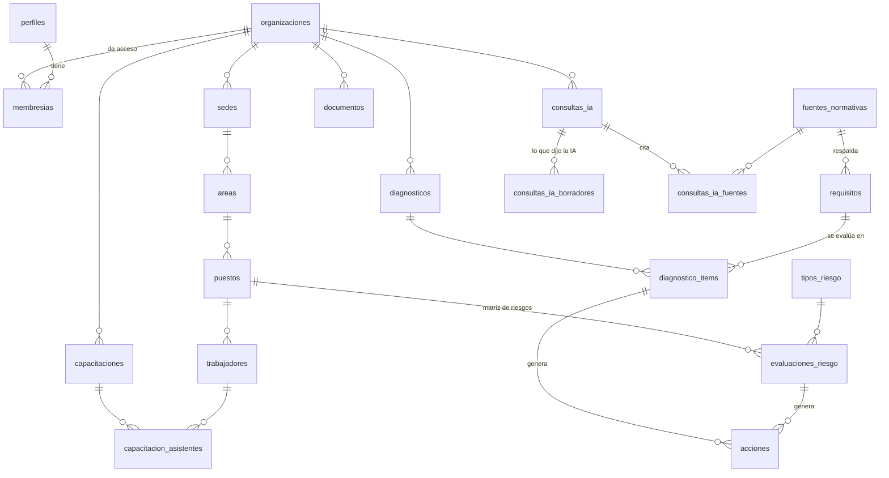

# Modelo de datos

> Dueño: Sebastián Cervantes (CTO). Base de datos: PostgreSQL en Supabase.
> El código está en [`supabase/migrations/`](../supabase/migrations/). Si cambian una tabla, actualicen también este documento.

## Vista general

## Las tablas, en palabras simples

### Clientes y usuarios
| Tabla | Qué guarda |
|---|---|
| `organizaciones` | Cada empresa cliente: RUC, razón social, actividad CIIU, nº de trabajadores, plan. |
| `perfiles` | Cada persona que entra al sistema. Se crea sola al registrarse. `es_equipo_act = true` para el equipo de ACT. |
| `membresias` | Qué persona del cliente ve qué empresa, y con qué rol: `admin_cliente`, `responsable_sst` o `lectura`. |

### Estructura de la empresa
| Tabla | Qué guarda |
|---|---|
| `sedes` | Centros de trabajo (algunas obligaciones se cuentan por sede). |
| `areas` | Producción, ventas, bodega… |
| `puestos` | Cargo, tareas y cuántas personas están expuestas. |
| `trabajadores` | Datos **mínimos**: nombre, cédula, puesto. **Sin datos de salud.** |

### Cumplimiento (el corazón del MVP)
| Tabla | Qué guarda |
|---|---|
| `fuentes_normativas` | Cada artículo de norma con enlace oficial. Columna `verificada` se vuelve `true` solo cuando una persona llena `verificado_por` y `fecha_verificacion`. |
| `requisitos` | Obligación verificable ("¿tiene delegado de SST?"), a partir de cuántos trabajadores aplica y qué evidencia la demuestra. |
| `diagnosticos` | Una revisión a una empresa en una fecha. |
| `diagnostico_items` | Resultado por requisito: `cumple`, `parcial`, `no_cumple`, `no_aplica`, `sin_evaluar`. |
| `resumen_diagnosticos` *(vista)* | % de cumplimiento automático (parcial = medio punto). |

### Gestión de riesgos y seguimiento
| Tabla | Qué guarda |
|---|---|
| `tipos_riesgo` | Catálogo: físicos, químicos, biológicos, de seguridad, ergonómicos, psicosociales. |
| `evaluaciones_riesgo` | Matriz de riesgos: peligro, probabilidad × severidad (1–5) → nivel y clasificación automática. |
| `acciones` | Plan de acción: qué hacer, jerarquía de control, responsable, fecha límite, estado. |
| `capacitaciones` / `capacitacion_asistentes` | Qué capacitación se dio, cuándo, y quién asistió. |
| `documentos` | Política, reglamento, plan de emergencia… con versión y estado. El archivo va en Storage. |

### Agente de IA con supervisión humana
| Tabla | Qué guarda |
|---|---|
| `consultas_ia` | La pregunta del cliente, el estado de revisión y la `respuesta_final` aprobada. |
| `consultas_ia_borradores` | Lo que generó el modelo. **Solo lo ve el equipo ACT**, nunca el cliente. |
| `consultas_ia_fuentes` | Qué normas cita cada respuesta. |
| `normativa_para_agente` *(vista)* | Lo único que el agente puede leer: normas verificadas y vigentes. |

## Reglas que la base de datos hace cumplir sola

| Regla | Cómo |
|---|---|
| Un cliente solo ve su empresa | Row Level Security (migración 002) |
| Sin login no se ve nada | Se revocan permisos a `anon` |
| Nadie se da permisos de "equipo ACT" | Trigger `proteger_equipo_act` |
| No se cita normativa sin verificar | Trigger `validar_fuente_citada` |
| No se aprueba una respuesta sin fuente | Trigger `validar_aprobacion_ia` (salvo `sin_norma_aplicable`) |
| Una acción cumplida tiene fecha de cierre | `check` en `acciones` |
| Archivos privados por empresa | Bucket `documentos`, ruta `<organizacion_id>/...` (migración 003) |

Las pruebas de todas estas reglas están en [`supabase/pruebas_locales/`](../supabase/pruebas_locales/).

## Próximas migraciones (cuando el MVP lo pida)

- **004 — Salud y discapacidad**: ajustes razonables, aptitud médica, consentimiento del trabajador. Acceso solo para roles autorizados, con registro de quién consulta.
- **005 — Incidentes y accidentes**: registro, investigación y vínculo con `acciones`.
- Validación del dígito verificador de cédula y RUC.

## Cómo cambiar el esquema

1. **Nunca** editen una migración que ya se aplicó en la base real. Creen un archivo nuevo: `supabase/migrations/AAAAMMDDHHMMSS_descripcion.sql`.
2. Si agregan una tabla con datos de clientes, **actívenle RLS y sus políticas en la misma migración**.
3. Corran las pruebas locales antes de abrir el Pull Request.
